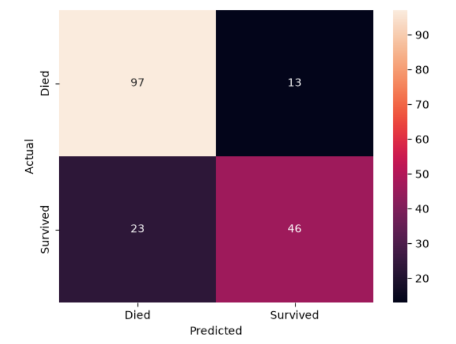
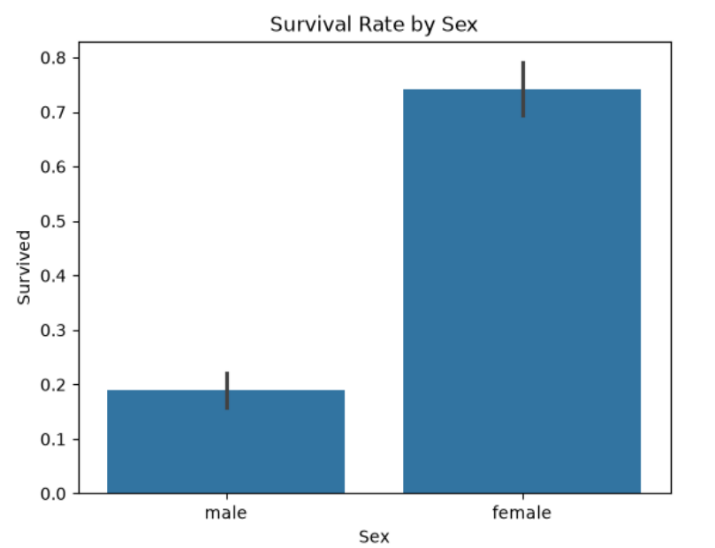
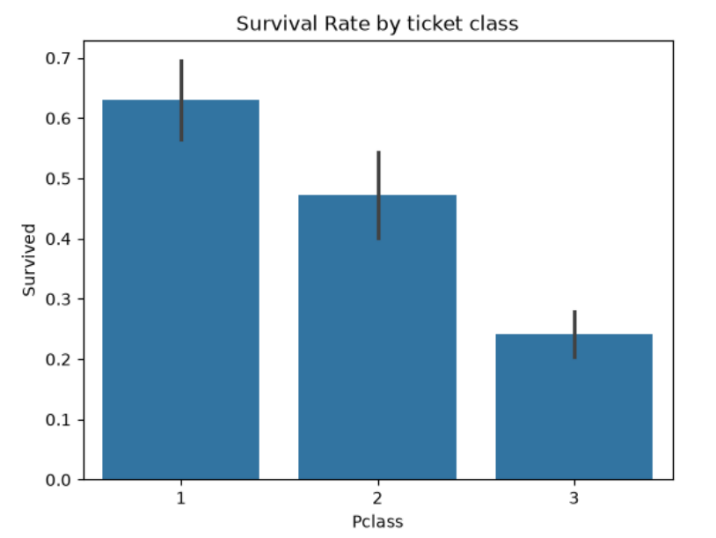
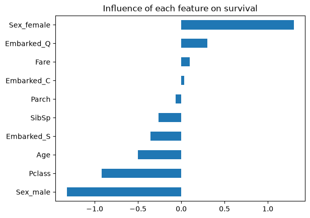

<h1 align="center">🚢 Titanic Survival Classification</h1>

<p align="center">
  Predicting passenger survival with machine learning<br>
  <b>Arch Technologies · Data Science Internship · Task 1</b>
</p>

<p align="center">
  
  
  
  
</p>

---

## 📌 Overview

This project builds a supervised **binary classification** model that predicts whether a Titanic passenger survived, using details such as age, sex, ticket class and fare.

The Kaggle training set (891 passengers) was explored, cleaned, converted to numeric form and split 80/20 into training and test sets. A **Logistic Regression** classifier reached **79.9% accuracy on unseen passengers**, close to its 80.8% training accuracy, which shows it generalises well.

**Key findings**
- 👩 Women survived far more often than men (**74.2% vs 18.9%**).
- 🎟️ Survival fell with each step down in ticket class (**63.0% → 47.3% → 24.2%**).
- ⚠️ The main weakness is recall for survivors (**66.7%**): the model misses about one in three people who actually survived.

## 📊 Results

| Metric | Result |
| --- | --- |
| Training accuracy | 80.8% |
| **Test accuracy** | **79.9%** |
| Precision (survived) | 78.0% |
| Recall (survived) | 66.7% |
| F1-score (survived) | 71.9% |

A baseline that predicts "did not survive" for everyone scores about 62%, so the model clearly beats it.

### Confusion matrix (179 test passengers)

<p align="center">
  
</p>

The model correctly identified 97 passengers who died and 46 who survived. It wrongly predicted survival for 13 passengers who died, and missed 23 who survived.

## 🔎 Exploratory Data Analysis

<p align="center">
  
  
</p>

- **Target balance:** 549 passengers (61.6%) did not survive, 342 (38.4%) did.
- **Missing values:** Age 177 (19.9%), Cabin 687 (77.1%), Embarked 2 (0.2%).

### Which features matter most?

<p align="center">
  
</p>

Sex has the largest influence (female raises, male lowers the odds of survival), followed by ticket class and age, which matches the "women and children first" evacuation.

## 🧹 Data Preprocessing

| Step | What was done | Why |
| --- | --- | --- |
| Missing `Age` | Filled with the median | Not pulled by a few very old passengers |
| Missing `Embarked` | Filled with the most frequent port (S) | It is a category, so the mode is natural |
| `Cabin` | Dropped | 77% missing, too many to fill reliably |
| `PassengerId`, `Name`, `Ticket` | Dropped | Unique per passenger, no pattern to learn |
| `Sex`, `Embarked` | One-hot encoded | Avoids implying a false order between categories |
| Train/test split | 80/20, stratified, `random_state=42` | Honest test on unseen data with equal survival rates (38.3% / 38.5%) |
| Numeric columns | Standardised with `StandardScaler` | Age and Fare are on very different scales |

**Final features:** `Pclass`, `Age`, `SibSp`, `Parch`, `Fare`, `Sex`, `Embarked` → **712** training and **179** test passengers.

## 🤖 Model

**Logistic Regression** (scikit-learn, `max_iter=1000`). It combines the features into a probability of survival and predicts "survived" when that probability is above 50%. It was chosen because it is fast, interpretable and a strong first model for this kind of problem.

## 📁 Project Structure

```
titanic-survival-classification/
├── data/
│   └── README.md                      # How to download train.csv from Kaggle
├── images/                            # Charts used in this README
├── notebooks/
│   └── Titanic_Survival_Classification.ipynb   # Full analysis with outputs
├── src/
│   └── titanic_classification.py      # End-to-end pipeline script
├── requirements.txt
├── LICENSE
└── README.md
```

## ⚠️ Limitations

- Small dataset (891 passengers): the test score comes from only 179 people and could shift with a different split.
- About 20% of ages were missing and replaced with the median, so those values are estimates.
- Recall for survivors is 66.7%: the model misses a third of the people who survived.
- Only one model and one train/test split were used.

## 🔮 Future Improvements

- [ ] Compare Logistic Regression with other models such as Random Forest.
- [ ] Engineer new features, e.g. family size (`SibSp + Parch + 1`) and passenger title (Mr, Mrs, Miss, Master) from `Name`.
- [ ] Use cross-validation for a more stable accuracy estimate and tune hyperparameters.

## 🛠️ Tech Stack

Python · pandas · matplotlib · seaborn · scikit-learn · Jupyter

## 📚 Dataset

[Titanic: Machine Learning from Disaster](https://www.kaggle.com/c/titanic) (Kaggle), training file, 891 rows × 12 columns.

## 👤 Author

**Areej Simab**
Data Science Intern, Arch Technologies

- GitHub: [@AreejSimab](https://github.com/your-username)
- LinkedIn: www.linkedin.com/in/areej-simab-3718502a3

## 📄 License

Released under the [MIT License](LICENSE).
